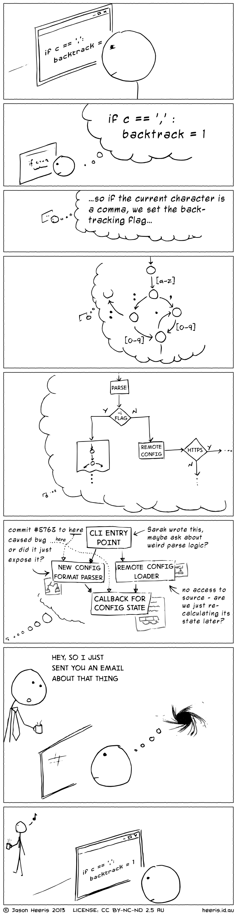

So what do i mean with `control temptation @ work`. When working with development you have to get it to a problem and try to solve it. Doing that requires that you can stay focused on the task in hand to get the most out of it. Lets say you take 10 - 15 min to get it to the right flow. During your day you have email, facebook, online newspapers, chat systems like `IRC`, `HipChat`, `Skype`, colleagues and many others things that can make you get out of your productive flow. The result of this will mean for every time you lose the 10 - 15 min to get in to the productive flow, over and over. And you may end up at the end of that day and realizing that you did not get done with what you wanted. That is not fun for anyone. 

What i have done to solve this for me! Is to have most notifications on my ´iPhone´ off like facebook, mail and other applications that may have possible notifications during the day. On my work laptop i have turned off mail notifications since i dont need to check every mail that pops up in the notifications window right away. I have delibretly not signed in and saved my login to facebook and other sites since i will have a hurdle to have to signs in. That will make me think do i really need to check this now NO. You may think what about the colleagues and all the conversations and noise that you have around you. A pair of `Bose quietcomfort 15` noise canceling headphones will help and take away most of the surounding noise that you may what to get away from to keep focus on the task in hand. 

lets end with a good picture that shows that problem well. 

