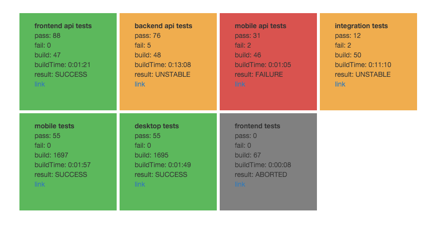

Minimal Jenkins test result dashboard



The background to making the dashboard is as part of the on boarding at work we are able to do a small projekt. We are using Jenkins as the tool for our continuous integration tests like many others. Since most of the Jenkins plugins that exists for build information is not that pretty, it made a lot of since to do a minimalistic dashboard for the test results. And why not do something in React as the frontend rendering engine and python as the backend. The dashboard is also using redis cache for the result data, and in the docker stack haproxy to terminate http on port 80. The frontend polls the backend every 15 sec for new data. 

To get up and running with the dashboard you have two options either you run it with docker using `make` and docker-compose to start the stack. Or you install the needed on the host you have and have it running like that.

Install instructions for my minimal test result dashboard. pre install assumtions is that you have docker/docker-compose installed
```bash
$ git clone https://github.com/qoneci/dashi.git
```

copy the example config file and edit it to work you your Jenkins. Start with the Jenkins config, by adding the jenins host, followed by a user and the user token the transport type http or https, and the exact job name in Jenkins this is only tested when the name is \<name\>-\<name\>, add a shorter description that you like to see in the frontend cards. The the redis configuration, if you are running using docker just set the host to redis, and leave the rest. the poll interval for collecting data from Jenkins is set by the poll\_interval key the default is set to 10 sec. The redis data have a config value expire\_time 30 default, if no data is in redis the backend will get data from Jenkins.
```bash
$ cp example.config.yml config.yml
```

start the docker-compose stack
```bash
$ docker-compose up -d
```
