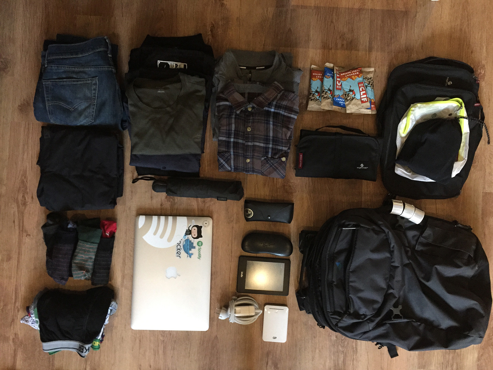
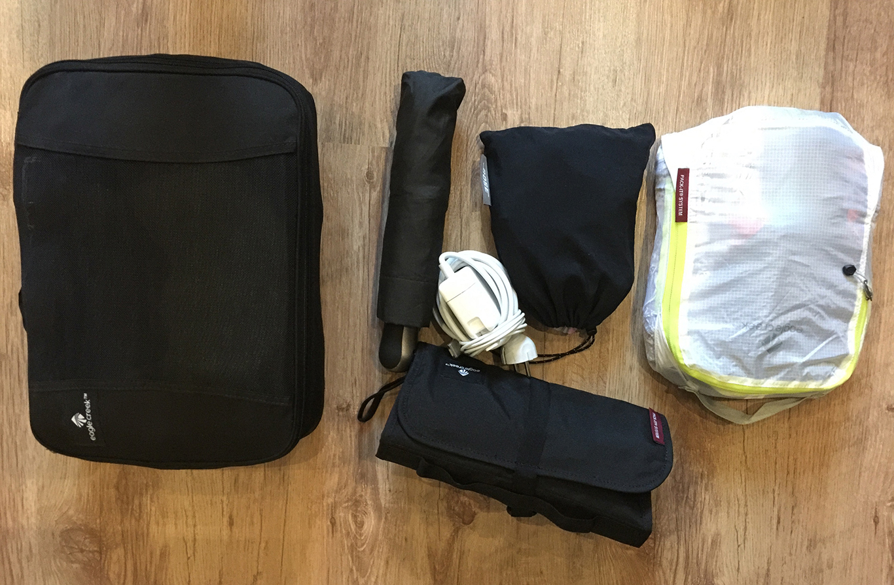
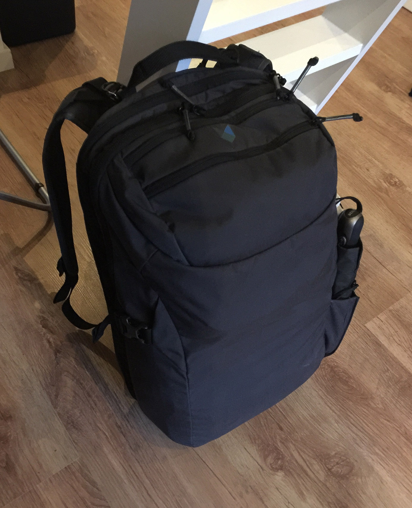

Travel with a `Minaal`. I am using packing cubes to organize my clothes. When i am packing clean clothes i am roling them and packing them in the packing cudes. This stops somewhat wrinkled clothes. The `Minaal` it self is greate to have some weight in. Backpacks i have used before in a [Mission Workshop Vandal](http://missionworkshop.com/products/bags/backpacks/roll_top/large_vandal.php). That one is grate but it's heavy. Load in the `Minaal` works grate with a heavy macboook pro retina 15, since it's close to the back the for some resoce it's not fealing that heavy. Also having lot's of small pockets to packing in is grate, Even some hidden ones like the one in the bottom of the main compartment. When going trough the airport security the laptop pocket makes it easy to just take out and put back again. 

All of the stuff before packing. Not in the picture is the Nike Free shoes, the SCO jacket and some cables to the iPhone Kindle, and the PowerBank. 

Everything packed in the smal and big packing cube. 

Now all packed in the `Minaal` 

List of most of the items. 

* [Minaal Carry-On](http://www.minaal.com/products/minaal-carry-on-bag)
* [Exped Crush Drybag](http://www.amazon.com/Exped-2010145-Crush-Drybag/dp/B0038WO4Z4)
* [Kindle paperwhite 2](http://www.amazon.com/Kindle-Paperwhite-High-Resolution-Display-Built-/dp/B00JG8H09Q)
* [RayBan Wayfarer](http://www.amazon.com/Ray-Ban-RB2132-Wayfarer-Polarized-Sunglasses/dp/B002Y2YSIC)
* [RayBan clubmaster prescription glasses](http://www.amazon.com/Authentic-clear-Designer-Eyeglasses-Apparel/dp/B0026PJDQE)
* [umbrella ](http://www.naturkompaniet.se/brunngard-ab-storm-3-fold-automatic)
* [eagle creek - Pack-It Specter Cube](http://shop.eaglecreek.com/packitspectercube/d/1141_c_476_cl_2046)
* [eagle creek - Pack-It Cube](http://shop.eaglecreek.com/packit-cube/d/1321_cl_2529)
* [eagle creek - Pack-It Slim Kit](http://shop.eaglecreek.com/packit-slim-kit/d/1343_cl_2700)
* [Portable PowerBank GL301](http://www.gpbatteries.com/INT/index.php?option=com_k2&view=item&id=347&Itemid=620)
* [Chrome STORM](http://www.chromeindustries.com/us/en/apparel/mens-apparel/chrome-storm/storm-cobra)
* [Macbook Pro Retina 15" 2013](http://store.apple.com/us/buy-mac/macbook-pro)
* [Nike element half-zip](http://store.nike.com/dk/en_gb/pd/element-running-top/pid-872696/pgid-10294800)
* [Nike free flyknit 4.0 - Black 2015](http://store.nike.com/dk/en_gb/pd/free-4-flyknit-running-shoe/pid-10239055/pgid-10334425)
* [icebreaker - Tech T Lite Short Sleeve](http://eu.icebreaker.com/en/mens-tshirts/tech-t-lite-short-sleeve/100898.html)
* [icebreaker - Cool-Lite Sphere Short Sleeve Polo](http://eu.icebreaker.com/en/mens-tops/cool-lite™-sphere-short-sleeve-polo/102395.html)
* [icebreaker - Anatomica Boxers](http://eu.icebreaker.com/en/mens-underwear/anatomica-boxers/100471.html)
* Old Vailent shirt from [carlings](http://carlings.com/)
* [iPhone 6 Plus](http://store.apple.com/us/buy-iphone/iphone6)
* [SOC M GAIT - Running jacket](http://www.stadium.se/sport/lopning/loparklader/205771/soc-m-gait-led-jkt?SelectedProductUUID=wbvCROin.egAAAFIs5dsLVzO#.VUdmwc6YQXs)
* Socks
* Underwear
